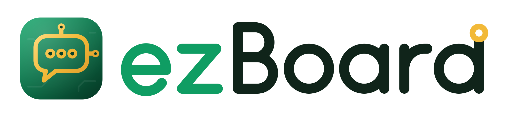

# ezBoard — 초보자를 위한 AI PCB 설계

말로 설명하면 AI(Claude · Gemini · GPT)가 회로를 설계하고, PCB 배치·배선·검사·주문 파일(거버)까지 만들어 주는 웹 앱입니다.

## 실행
```bash
npm install
npm run dev     # http://localhost:5173
```

## 사용 흐름
1. **회로 만들기** — 왼쪽 AI 창에 "버튼 누르면 LED 켜지는 회로"처럼 입력 (⚙️에서 API 키 입력). 키 없이 예제로도 체험 가능.
2. **회로도 확인** — 📐 회로도 화면에서 기호·전선으로 회로를 확인 (끌어서 정리, R/더블클릭 회전, 🧹 자동 정리)
3. **부품 배치** — 자동 배치 후, 부품을 끌어서 옮기기 (R: 회전, Delete: 삭제)
4. **배선** — ⚡ 자동 배선 (2층 A* 라우터, 전원선은 굵게)
5. **검사** — 겹침, 보드 밖, 미배선, 구리 간격, LED 저항 누락 등 초보자 실수 검사
6. **주문 파일** — 거버(RS-274X) + 드릴 + BOM zip → JLCPCB/PCBWay에 업로드

## 구조
- `src/lib/library.ts` 부품 라이브러리·풋프린트 (스루홀 위주)
- `src/lib/ai.ts` Claude/Gemini/OpenAI 연결, 시스템 프롬프트, 회로 JSON 파싱
- `src/lib/geometry.ts` 자동 배치, 래츠네스트
- `src/lib/router.ts` 자동 배선기
- `src/lib/symbols.ts`, `schematic.ts` 회로도 기호, 자동 배치, 직각 전선 배선
- `src/lib/drc.ts` 설계 규칙 검사
- `src/lib/gerber.ts`, `font.ts` 거버/드릴/BOM 생성
- `src/components/*` UI (채팅, PCB 캔버스, 오른쪽 패널, 설정)

API 키는 브라우저 localStorage에만 저장되고 각 AI 회사 API로 직접 전송됩니다.

## 엔진 테스트
```bash
npm run test:engine
npx tsx scripts/sch-user.ts   # 회로도 배치/배선 품질 측정
```

## 설치 파일 만들기

| 플랫폼 | 명령 | 결과 |
|---|---|---|
| macOS (Apple Silicon + Intel) | `npm run dist:mac` | `release/ezBoard-<버전>-mac-arm64.dmg`, `-mac-x64.dmg` |
| Windows x64 | `npm run dist:win` | `release/ezBoard-<버전>-windows-x64-setup.exe` |
| Linux x64 | `npm run dist:linux` | `release/ezBoard-<버전>-linux-x86_64.AppImage`, `-linux-amd64.deb` |
| Android | `npm run android:apk` | `android/app/build/outputs/apk/release/app-release.apk` (+ `bundle/release/app-release.aab`) |

- 데스크톱은 Electron, 안드로이드는 Capacitor로 같은 웹 앱을 감쌉니다. 모두 이 Mac에서 빌드됩니다.
- 안드로이드 빌드에는 JDK 21이 필요합니다: `export JAVA_HOME=/opt/homebrew/opt/openjdk@21/libexec/openjdk.jdk/Contents/Home`
- **안드로이드 서명 키**: `android/keystore/ezboard-release.jks` 와 `android/keystore.properties`(비밀번호). git에 올리지 않으며, **잃어버리면 같은 앱으로 업데이트를 낼 수 없으니 반드시 따로 백업하세요.**
- **macOS**: Apple 개발자 인증서가 없어 임시(ad-hoc) 서명만 되어 있습니다. 다른 Mac에서 처음 열 때 "확인되지 않은 개발자" 경고가 나오면 앱을 우클릭 → 열기. 정식 배포하려면 Developer ID 서명과 공증(notarization)이 필요합니다.
- **Windows**: 코드 서명 인증서가 없어 SmartScreen 경고가 나올 수 있습니다 ("추가 정보 → 실행").
- 아이콘은 `logo/mark.svg`에서 `npm run icons`로 다시 만듭니다. 스토어용 스크린샷은 `npm run screenshots` (`screenshots/` 폴더).
- 화면 언어: 한국어 / English (시스템 언어를 따르고, 상단 `EN`/`한` 버튼이나 ⚙️ 설정에서 바꿀 수 있음)
